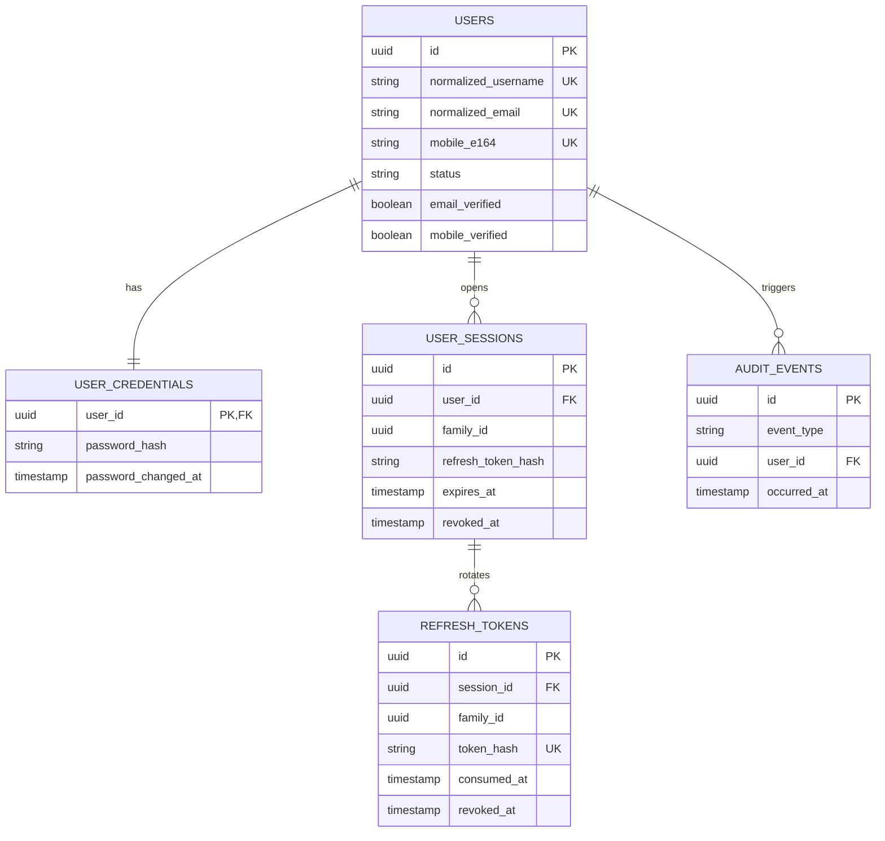
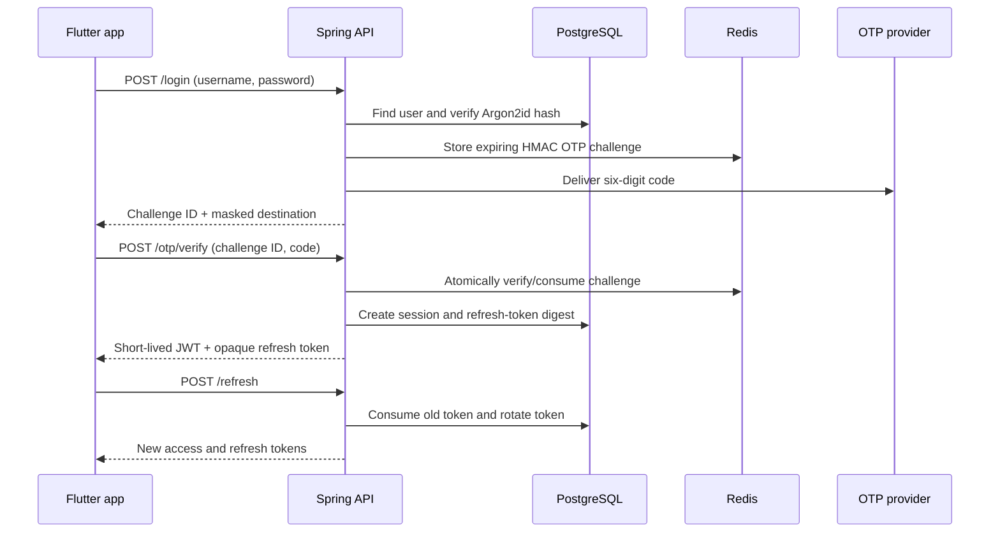

# Authentication backend

## Module responsibilities

- `auth.presentation`: HTTP controllers and request/response DTOs.
- `auth.application`: authentication workflows, OTP and token services.
- `auth.domain`: investor account model.
- `auth.infrastructure`: JPA repositories and Redis OTP storage/delivery.
- `onboarding`: owner-scoped investor application, validation, PAN/KYC ports,
  provider adapters, persisted workflow/status history and onboarding APIs.
- `mutualfund.infrastructure.amfi`: official AMFI HTTP clients, independent
  report parsers, validation, mapping, import audit, scheduling and backfill.
- `shared`: security, API error envelopes, password policy and audit writes.

Persistence entities are not serialized through controllers. PostgreSQL schema
is versioned in `src/main/resources/db/migration`; Hibernate uses `validate`.
`users` stores normalized unique identifiers; `user_credentials` stores the
Argon2id password hash separately.
`user_sessions` and `refresh_tokens` store only refresh token SHA-256 digests.
`audit_events` excludes credentials and token values. OTP challenge hashes and
short-lived attempt counters reside in Redis.



## Authentication sequence



## Local setup

See the repository root README for environment variables and `docker compose`
instructions. The backend requires Java 21, Maven, PostgreSQL and Redis. Never
commit `.env`, keys, generated credentials, passwords or OTPs.

`JWT_HMAC_SECRET` and `OTP_HMAC_SECRET` are independent Base64-encoded random
keys with at least 256 bits. HMAC JWT signing was chosen to keep local setup
small; production should move to asymmetric signing and a managed key-rotation
strategy before use. `application-prod.yml` requires explicit CORS origins.

The onboarding PAN HMAC key and AES-256 encryption key are configured
independently as `PAN_HMAC_SECRET` and `PAN_ENCRYPTION_KEY`. Key rotation and
recovery must be provided by a managed KMS before production. See
`docs/onboarding.md` at the repository root for the scope, onboarding endpoints,
ERD, mocked-provider behavior, and remaining compliance work.

## API examples

Registration:

```json
{
  "username": "sample_investor",
  "password": "a-long-unique-secret",
  "email": "investor@example.test",
  "mobileNumber": "+919876543210"
}
```

Login starts an OTP challenge and does not issue access tokens:

```json
{
  "username": "sample_investor",
  "password": "a-long-unique-secret"
}
```

All API errors use `{ "success": false, "error": { "code": "...", "message":
"..." }, "timestamp": "..." }`. Internal exception details are not returned.

## Important limitations

- No SMS/email vendor is included. The local/test provider logs OTP values only
  under those profiles; non-local profiles fail closed until a delivery adapter
  is configured.
- The reset-request response is account-enumeration-neutral. For unknown
  identifiers, it returns an unbacked challenge reference; the submitted reset
  is rejected generically.
- Rate limiting is Redis-backed by normalized identity and does not replace
  ingress-level IP/device abuse controls.
- Session liveness is checked against PostgreSQL for bearer-authenticated
  requests. This is intentionally straightforward, but should be reviewed for
  throughput and availability characteristics.
- Backend unit and integration test coverage is not yet complete. Run
  `mvn test` with Java/Maven available and add PostgreSQL/Redis Testcontainers
  lifecycle/concurrency tests before production.

## Official AMFI NAV integration

AMFI is the configured production NAV source. No third-party NAV provider or
fixture is used as a production fallback. The mock provider is limited to the
`local` and `test` Spring profiles and its seed option defaults to disabled.
When AMFI fails, the last imported PostgreSQL records remain available; the
failed execution is logged and recorded, and the sync does not switch sources.

The AMFI report formats and download types were verified against live AMFI
responses during implementation:

| Report | Official URL | Format |
|---|---|---|
| Latest NAV | `https://portal.amfiindia.com/spages/NAVAll.txt` | Semicolon-delimited text. Header columns: Scheme Code, two ISIN columns, Scheme Name, Plan, Option, Net Asset Value, Date. AMC and category/type are heading rows. |
| Historical NAV | `https://portal.amfiindia.com/DownloadNAVHistoryReport_Po.aspx` | Semicolon-delimited text with a distinct order: Scheme Code, NAV Name, Plan, Option, two ISIN columns, Net Asset Value, Date. |

Historical requests use the verified query parameters `tp`, `frmdt` and
`todt`; dates use `dd-MMM-yyyy` with English month names. Live probes returned
`tp=1` for open-ended, `tp=2` for close-ended and `tp=3` for interval schemes.
These are observed endpoint behaviors, not a guarantee of an AMFI service
contract; response headers and report columns are checked at runtime and
unexpected data is rejected and audited. NAV values are parsed as
`BigDecimal`; report rows retain their raw text, source line and execution
provenance. Reimports upsert by scheme/date so corrections are applied
idempotently.

AMFI NAV reports provide scheme codes, names, plan/option labels, two ISIN
fields, NAV/date, and report headings that identify AMC and category/type.
They do **not** provide the integration with expense ratio, AUM, fund manager,
investment objective, benchmark, exit load, minimum investment, riskometer or
scheme documents. Those fields remain unavailable/null; they are not inferred.
The AMFI Scheme Data Download facility has not yet been verified as a separate
machine-readable master with additional fields, and no other official AMC or
regulatory metadata source has been validated for those attributes. Do not
present unavailable fields as AMFI-sourced.

Read-only mutual-fund scheme, category, AMC, detail, NAV history, performance
and comparison API routes are public; investor watchlist and AMFI admin
operations remain authenticated (admin refresh/backfill also require the
configured user allowlist).

### Operating the sync

- Set `AMFI_NAV_SYNC_CRON` to an operator-approved cron expression after
  confirming the deployment's expected AMFI publication window. Scheduling is
  disabled by default; NAV is not real-time.
- Configure `AMFI_ADMIN_USER_IDS` as a comma-separated allowlist of UUID user
  IDs to enable the protected manual operations:
  `POST /api/v1/admin/mutual-funds/amfi/refresh` and
  `POST /api/v1/admin/mutual-funds/amfi/backfill?from=2025-01-01&to=2025-01-07`.
- Backfill splits date ranges into chunks of up to 31 days (default seven),
  stores one execution per range and report type, and can be safely rerun.
  Upserts prevent duplicate scheme/date history; inspect
  `amfi_sync_execution` for successful, partial and failed ranges.
- `AMFI_RETRY_ATTEMPTS`, `AMFI_RETRY_BACKOFF`, `AMFI_CONNECT_TIMEOUT`,
  `AMFI_READ_TIMEOUT` and `AMFI_BACKFILL_CHUNK_DAYS` tune network and chunk
  behavior.
- `amfi_source_record_audit` records raw accepted/rejected report rows and
  rejection reasons. `scheme_nav_history` records the AMFI scheme code, report
  type, execution ID and import timestamp for each NAV.
- Mutual-fund read responses use a five-minute Redis cache. Successful AMFI
  refreshes and backfills evict the affected caches.

The parser tests include short captured snippets from live AMFI responses and
separate edge-case fixtures for each report layout. Live endpoint response
checks were performed, but database persistence, API retrieval and Flutter
display have not yet been verified end-to-end in a configured PostgreSQL/Redis
deployment. Run the backend tests and apply Flyway migrations through `V4`
before enabling sync.
