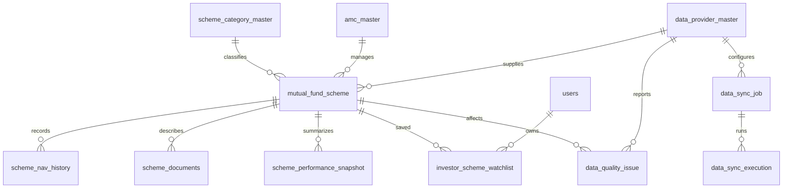

# Mutual fund discovery and research

## Status and boundaries

The discovery module provides authenticated scheme search, scheme information,
historical NAV, NAV-based performance, comparison, and investor-owned
watchlists. It does not depend on onboarding or KYC status: an authenticated
investor can use discovery before completing onboarding.

This is a research-only feature. It has no purchase, redemption, SIP
registration, order, or transaction endpoint. Information shown is not
personalized investment advice.

No licensed market-data provider, production data feed, credentials, or data
license is configured. The local demo repository/provider contains synthetic
illustrative fixtures and must not be presented as real fund or market data.
Production mode must use a reviewed, licensed provider and validated data.
Scraping is not an approved source.

## Flutter routes

All investor paths inherit authentication from the common router guard.

| Route | Purpose |
|---|---|
| `/investor/funds` | Search and filter schemes |
| `/investor/funds/{schemeId}` | Scheme information, NAV history and performance |
| `/investor/compare` | Side-by-side comparison of up to four selected schemes |
| `/investor/watchlist` | Current investor's saved schemes |

Discovery is linked from Investor home and the education listing. These links
do not check KYC state.

## API

Endpoints use `/api/v1` and the standard response envelope. They require a
valid authenticated bearer token.

| Method | Path | Purpose |
|---|---|---|
| GET | `/mutual-funds/schemes` | Search/filter/paginate schemes |
| GET | `/mutual-funds/schemes/{schemeId}` | Scheme detail |
| GET | `/mutual-funds/schemes/{schemeId}/nav-history` | NAV points for date range and interval |
| GET | `/mutual-funds/schemes/{schemeId}/performance` | Calculated performance metrics |
| POST | `/mutual-funds/schemes/compare` | Compare selected schemes (maximum four) |
| GET | `/investors/me/watchlist` | List watchlisted schemes |
| POST | `/investors/me/watchlist/{schemeId}` | Save a scheme |
| DELETE | `/investors/me/watchlist/{schemeId}` | Remove a scheme |

Watchlist ownership is derived from the authenticated identity, never from a
client-supplied investor identifier. Duplicate saves are idempotent.

## Performance and NAV interpretation

- NAV history and performance data carry a source and as-of date where
  available; missing history is reported as unavailable rather than replaced
  with an estimated return.
- Period returns use NAV observations. Absolute returns are used for periods
  under one year; CAGR uses actual elapsed days for longer periods.
- IDCW distributions are excluded from NAV-only return calculations and that
  limitation is disclosed. NAV-based results are not total returns.
- Insufficient history is unavailable. Past performance is not indicative of
  future returns.
- Growth and IDCW are separate scheme options. The available plan scope is
  Regular only.

## Data model

Migration `V3__mutual_fund_discovery.sql` defines:

- AMC, category, provider, and scheme master records.
- Time-series NAV observations and scheme documents.
- Materialized performance snapshots.
- Investor-scoped watchlists.
- Sync jobs/executions and data-quality issue records.

NAV and financial amounts use PostgreSQL `NUMERIC`. The scheme master keeps
provider identifiers and timestamps needed for reconciliation and freshness.
Only provider-authoritative data should be imported into non-demo records.

## Provider and operations

`MutualFundDataProvider` is the integration boundary; `MutualFundSyncService`
normalizes and upserts provider records. A mock provider and fixtures are
available only for local/test use and are not an operational market-data feed.
Before production, configure a licensed source, document permitted display and
retention, set freshness and reconciliation rules, and monitor sync failures
and data-quality issues. Never imply that demo fixtures are live NAV data.

## Security and non-goals

Common API security protects all endpoints; no KYC status check is performed
for discovery. Watchlists are scoped to the signed-in investor. Search values
must remain bound SQL parameters and sort fields must be allowlisted. No
transaction operation is part of this module.

## Verification status

Flutter and backend checks must be run against the current implementation
before release. Backend migrations and tests require Java 21, Maven, and
PostgreSQL. A passing local UI test does not validate provider data,
performance correctness at production scale, or regulatory suitability.
