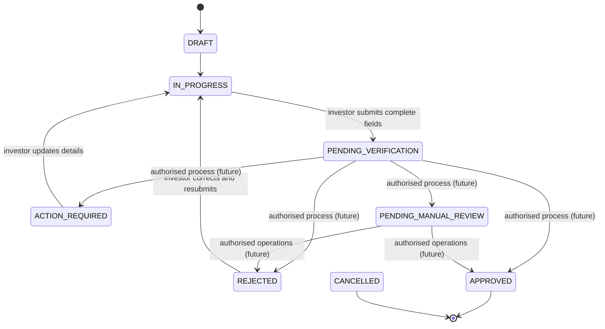
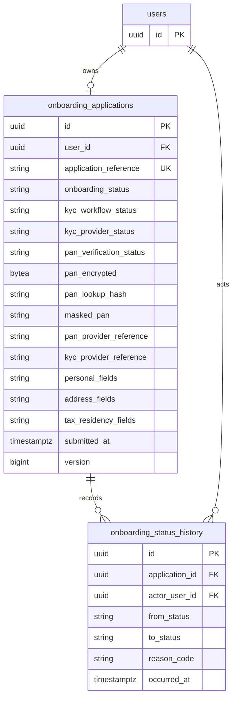

# Investor onboarding and KYC foundation

## Scope and implementation status

This is the first implementation slice of Phase 3, not the complete Phase 3
acceptance scope. It adds a resumable application, owner-scoped APIs, personal
information, residential address, a tax-residency declaration, PAN capture
through provider ports, an existing-KYC check port, application submission,
status tracking, and a Flutter wizard. Bank verification, nominees, documents,
consent template/evidence management, notifications, operations review, and
provider callbacks are not implemented.

The local PAN adapter returns `PENDING`; the local KRA/CKYC adapter returns
`UNKNOWN`. Neither a PAN format check nor either mock result marks an investor
verified or activated. No commercial PAN, KRA, CKYC, bank, e-signature, or
digital-KYC provider is connected.
The Flutter-only `AUTH_MODE=mock` preview stores onboarding values in memory
only; backend mode persists drafts in PostgreSQL.

## Workflow



Only the investor transitions to `IN_PROGRESS` by saving a section and to
`PENDING_VERIFICATION` by submitting. There is no investor-facing approval
operation. The KYC provider-reported status (`VALIDATED`, `REGISTERED`,
`ON_HOLD`, `REJECTED`, `PENDING`, `UNKNOWN`), Surgam KYC workflow status, PAN
verification status, onboarding status, and account activation are separate.
Currently, downstream reviewer-controlled transitions are only represented
in the status model and are not implemented as operations endpoints.

## Data model



The current migration stores the one personal profile, address, and tax
declaration as columns on the user's single application. This is a deliberate
small-scope model and should be normalized into versioned records before
supporting multiple addresses, multiple tax residencies, or historical
declarations. Migration: `backend/src/main/resources/db/migration/V2__investor_onboarding.sql`.

## API

All endpoints require an authenticated active-session bearer token and scope
the application to the token subject. A missing or non-owned application
returns the same not-found response.

| Method | Path | Purpose |
|---|---|---|
| POST | `/api/v1/onboarding` | Create or resume the investor's application |
| GET | `/api/v1/onboarding/current` | Get current application |
| GET | `/api/v1/onboarding/{applicationId}` | Get owned application |
| PUT | `/api/v1/onboarding/{applicationId}/personal` | Save validated personal details |
| PUT | `/api/v1/onboarding/{applicationId}/address` | Save residential address |
| PUT | `/api/v1/onboarding/{applicationId}/tax-residencies` | Save acknowledged declaration |
| POST | `/api/v1/onboarding/{applicationId}/pan/verify` | Validate format and request provider verification |
| POST | `/api/v1/onboarding/{applicationId}/kyc/status-check` | Check existing KYC via provider port |
| POST | `/api/v1/onboarding/{applicationId}/submit` | Validate required fields and submit |
| GET | `/api/v1/onboarding/{applicationId}/status` | Retrieve current tracking status |

Submission currently requires personal details, an address, a tax declaration,
and a PAN verification request. Because mock providers do not verify identity,
submission remains `PENDING_VERIFICATION`, never `APPROVED`.

## Sensitive-data and provider controls

- PAN format is validated server-side; raw PAN is not part of any response.
- PAN is encrypted using AES-256-GCM with a fresh random nonce for every write.
- A keyed HMAC supports duplicate lookup; a masked representation is returned.
- `PAN_HMAC_SECRET` and `PAN_ENCRYPTION_KEY` are required configuration and
  have no code defaults. Production must use a managed key service with rotation,
  access logging, and recovery procedures; the local env-file configuration is
  not a production key-management implementation.
- Provider interfaces are `PanVerificationProvider` and `KycProvider`.
  Local/test adapters are mock-only. Non-local profiles fail closed.
- PAN and KYC provider references are stored as metadata, but normalized
  provider event history, callback processing, idempotency, rate limiting,
  retries, circuit breakers, and provider audit metadata remain future work.
- The mock integration does not contact external networks and must not be
  represented as actual verification.

## Compliance decisions required before production

Legal/compliance owners must approve data minimization, fields, declaration
wording/versioning, tax/FATCA/CRS requirements, PAN/KRA/CKYC decision mapping,
the exact meaning of provider statuses, eligibility rules, retention/deletion,
manual review and maker-checker policy, and whether additional KYC steps are
required. No legal transaction eligibility is inferred from this implementation.

## Verification

Flutter checks:

```bash
flutter analyze
flutter test
```

Backend checks (not executed in the current environment because Java/Maven are
unavailable):

```bash
cd backend && mvn test
```

Database/Flyway behavior additionally requires the configured PostgreSQL
service. This project currently has no onboarding Testcontainers/API security
suite; those tests are still required before acceptance or production use.
